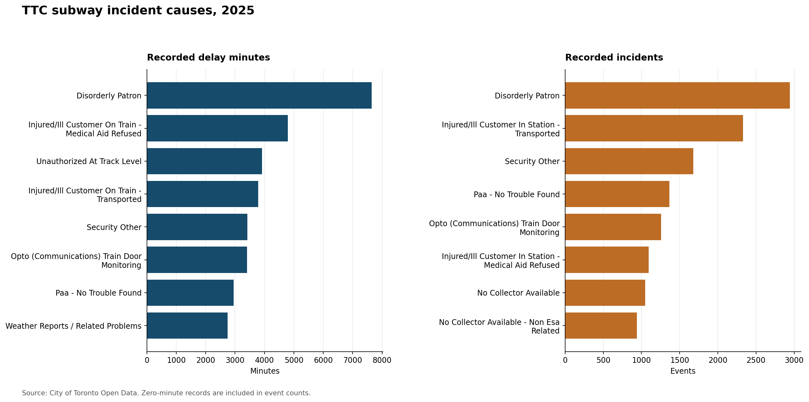

# TTC subway delay incident analysis (2025)

Which recorded subway incidents accounted for the most delay minutes in 2025? This project compares **incident counts** with **recorded delay minutes** by cause, line, and time of day. It uses the City of Toronto's public TTC subway delay log and its separate cause-code description table.



## Findings

- The 2025 snapshot has **25,737 recorded incidents** and **70,768 recorded delay minutes**. Of those incidents, **16,642** have zero recorded delay minutes; they remain in incident counts.
- `DISORDERLY PATRON` has the largest summed delay entry: **7,646 minutes** across **2,944 incidents**. Causes rank differently when sorted by incidents rather than minutes.
- Line 1 (YU) has **40,232 recorded delay minutes** across **13,087 incidents**. This is an unadjusted total, not a measure of line reliability.
- **145 records** have cause codes absent from the published description table. They remain labeled as unmapped; no cause is guessed for them.

The [full findings report](reports/findings.md) includes the line comparison, day/hour heatmap, cleaning decisions, and interpretation limits.

## Run from a clean checkout

Use Python 3.10 or newer. The committed data files are a fixed 2025 snapshot, so running the analysis does not require a network connection.

```bash
python3 -m venv .venv
.venv/bin/python -m pip install -r requirements.txt
.venv/bin/python ttc_analysis.py
.venv/bin/python -m unittest discover -s tests -v
```

The analysis verifies both snapshot checksums before reading them, then writes `reports/summary.json`, `reports/findings.md`, and three PNG charts. `fetch_snapshot.py` is an optional download script for building a new snapshot from the City of Toronto's live CSVs. Because the live data can change, rerunning that download can change the input checksum and findings.

## Method and data quality

The analysis joins incident codes to the published cause descriptions, parses dates and times, and standardizes known line aliases. It keeps zero-minute incidents, missing line labels, multi-line labels, and unmatched cause codes visible. Invalid dates, times, non-numeric delays, or negative delays are excluded and counted; fractional minutes stop the run rather than being rounded. The delivered 2025 snapshot has **zero excluded records**. `reports/summary.json` gives every diagnostic count.

Recorded delay minutes are summed from individual incident rows. The dataset does not provide passenger-level delay, train-service volume, or a comparable denominator for a line reliability rate. The analysis does not claim that a cause code proves why a specific passenger was delayed. The first and last hours of service can also differ from a standard full-service hour; the heatmap shows raw totals only.

## Data source and licence

Data: [City of Toronto, TTC Subway Delay Data](https://open.toronto.ca/dataset/996cfe8d-fb35-40ce-b569-698d51fc683b/). The repository includes the 2025 rows from the City's `TTC Subway Delay Data since 2025.csv` and the `Code Descriptions.csv` lookup. `data/SOURCE_SNAPSHOT.json` records the retrieval time, source URLs, and SHA-256 hashes. The lookup contains some damaged punctuation encoding in the published file; the script repairs it for display while preserving the source file and code mapping.

Contains information licensed under the Open Government Licence – Toronto. See the [licence terms](https://open.toronto.ca/open-data-licence/). This independent analysis is not endorsed by the City of Toronto or the TTC.
