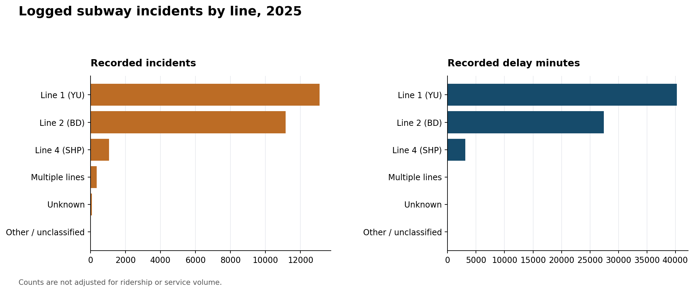
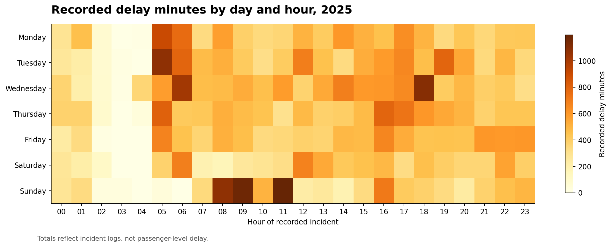

# TTC subway delay incident analysis, 2025

The City of Toronto's log contains **25,737 recorded incidents** in 2025. Of these, **9,095** have positive delay minutes. The log sums to **70,768 recorded delay minutes**. These minutes are incident-level entries, not passenger-hours lost.

## What the records show

- **Disorderly Patron** has the largest total: 7,646 minutes across 2,944 incidents (10.8% of all recorded delay minutes). The cause ranking changes when measured by events instead of minutes; both views are shown below.
- **Line 1 (YU)** has 40,232 recorded delay minutes (56.9% of the total) across 13,087 logged incidents. This is a workload total, not a reliability rate; lines have different service and ridership levels.
- The highest hourly total is **05:00-05:59**, with 4,463 recorded delay minutes across 1,187 incidents. The day-and-hour chart shows where those logged minutes cluster.

## Data checks and treatment

| Check | Rows |
| --- | ---: |
| Source snapshot (2025) | 25,737 |
| Excluded for invalid date, time, or delay | 0 |
| Included in analysis | 25,737 |
| Included with zero recorded delay minutes | 16,642 |
| Cause code without a matching description | 145 |
| Missing line, kept as Unknown | 77 |
| Multiple-line labels, kept separate | 354 |
| Other line labels, kept separate | 8 |

Invalid dates, times, non-numeric minutes, and negative minutes are excluded from the analysis. Their diagnostic counts are in `summary.json` and may overlap; the excluded-row total counts each row once. Zero-minute incidents stay in event counts and contribute zero minutes. Missing or unmatched cause codes remain visible rather than being assigned a guessed description. Line aliases such as YUS and LINE 1 are standardized, while mixed-line and non-subway route labels are kept separate. The source cause-description CSV contains damaged punctuation encoding; the analysis repairs those characters for display without changing the code-to-description mapping.

## Interpretation and next question

Start an operational review with causes that have high total recorded minutes, then compare them with incident counts so frequent short events and less frequent long events are not conflated. Before making staffing or service decisions, add train-service volume, ridership, and incident context. This dataset alone cannot estimate a passenger's delay, compare line reliability, or establish that an incident cause led to a particular operational outcome.

Source: [City of Toronto TTC Subway Delay Data](https://open.toronto.ca/dataset/996cfe8d-fb35-40ce-b569-698d51fc683b/), 2025 snapshot. Contains information licensed under the Open Government Licence – Toronto. See the [licence terms](https://open.toronto.ca/open-data-licence/).
