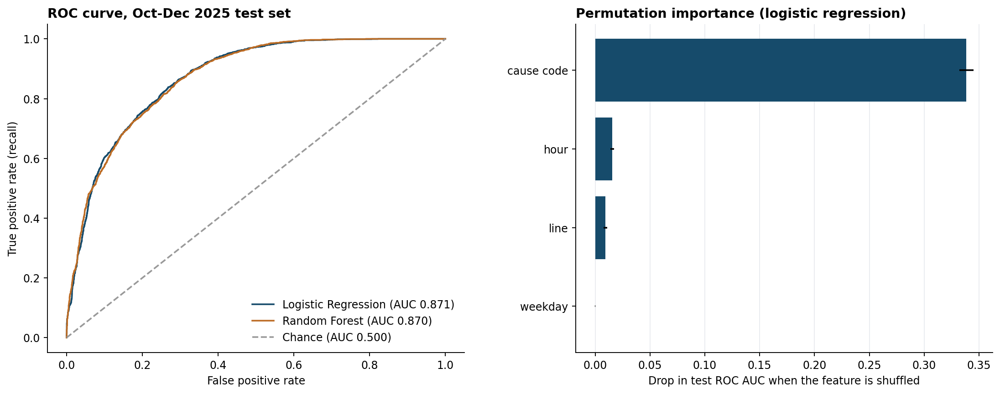

# Statistical tests and delay prediction, TTC subway 2025

This extension asks two questions about the same 25,737 incidents used in the main analysis: (1) do lines and time of day differ in delay outcomes, and (2) how well can an incident's line, day, hour, and cause code predict whether it delayed service (recorded delay minutes > 0)? It does not change the main report's figures. All results are associations in observational data, not causal effects.

## 1. Statistical tests

**Line vs. whether a delay occurred (chi-square test of independence).** Single-line incidents only (n = 25,298); "Multiple lines" rows are a logging category with no delayed rows. Delay rates: Line 1 38.6%, Line 2 33.1%, Line 4 33.1%. Chi-square = 85.7, df = 2, p = 2.4e-19, **Cramér's V = 0.058**. The difference is statistically clear but weak: with this sample size a small gap produces a tiny p-value, so the effect size matters more than the p-value.

**Weekday peak vs. other hours, minutes per delayed incident (Mann-Whitney U).** Peak = Monday-Friday 06:00-09:59 and 15:00-18:59. Only incidents with a delay are compared (3,281 peak, 5,814 other). Delay minutes are heavily right-skewed, so a rank test is used instead of a t-test. Median 4 vs. 5 minutes; p = 5.6e-49; probability a random peak delay is longer than a random off-peak delay = 0.409 (rank-biserial r = -0.183). **Peak-hour delays were slightly shorter**, a small-to-moderate effect. The data cannot say why.

## 2. Predicting whether an incident caused a delay

**Time-based split.** Train on 2025-01-01 to 2025-09-30 (19,253 incidents), test on 2025-10-01 to 2025-12-31 (6,484). A random split would let the model learn from incidents that happened after the ones it is tested on; a time split mimics using past data to predict future incidents. The 30 cause codes kept as their own levels are chosen from training rows only; rarer codes are pooled within their broad category (Equipment, Miscellaneous, Plant, Security, Transportation).

**Leakage excluded.** `Bound` and `Vehicle` are almost always blank or zero when no train was held: delayed share is 0.9% with a blank direction vs. 55.4% with one, and 1.8% with vehicle 0 vs. 59.5% otherwise. `Min Gap` is a second delay measure. All three describe the outcome rather than predict it, so none is used.

**Why not accuracy alone.** 63.3% of test incidents had no delay, so always predicting "no delay" already scores 63.3% accuracy with zero recall. Precision (of predicted delays, how many were real), recall (of real delays, how many were caught) and ROC AUC (ranking quality across all thresholds) are reported alongside accuracy. Classification uses a 0.5 probability threshold.

| Model (test set, Oct-Dec) | Accuracy | Precision | Recall | F1 | ROC AUC |
| --- | ---: | ---: | ---: | ---: | ---: |
| Always "no delay" baseline | 63.3% | - | 0.0% | - | 0.500 |
| Logistic regression | 78.8% | 71.4% | 70.5% | 0.710 | 0.871 |
| Random forest (300 trees, seed 42) | 78.8% | 71.6% | 70.0% | 0.708 | 0.870 |

Train-set AUC was 0.886 (logistic) and 0.904 (random forest). The forest fits training data more closely but does not do better on unseen months, so the simpler, interpretable logistic regression is preferred.

## 3. What drives the predictions

**The cause code carries almost all of the signal.** Without it (line, weekday, and hour only), test AUC falls to 0.584 (logistic) and 0.572 (random forest). Permutation importance agrees: shuffling the cause code costs far more AUC than shuffling any other feature.

Logistic-regression odds ratios compare each code with the most common training code, SUDP (Disorderly Patron), holding line, weekday and hour fixed:

| Code | Description | Odds ratio |
| --- | --- | ---: |
| PUTR | Rail related problem | 26.793 |
| MUSAN | Unsanitary vehicle | 15.289 |
| PUTWZ | Work zone problems - track | 8.245 |
| MUIS | Injured/ill customer in station - transported | 0.024 |
| PUMEL | Escalator/elevator incident | 0.009 |
| TUNCA | No collector available | 0.006 |

The pattern is mostly **on the track or train vs. in the station**: track, vehicle and on-train medical incidents usually hold trains, while station-only events (escalators, stairways, collector booths) almost never do. This explains the main report's observation that causes rank differently by incident count than by delay minutes: several of the most frequent codes are station events that log an incident but rarely any delay.

## Limitations

- Observational data: odds ratios and test results describe associations, not causes.
- Cause codes may be finalized after an incident, so this model explains the structure of delays more than it would serve as a real-time warning at the moment an incident starts.
- No weather, ridership, service frequency or staffing data, so line and time comparisons are not adjusted for exposure.
- One year of data and one train/test boundary; results for other years may differ.

Reproduce with `.venv/bin/python ttc_modeling.py` (fixed seed 42); numbers are in `results.json`.
